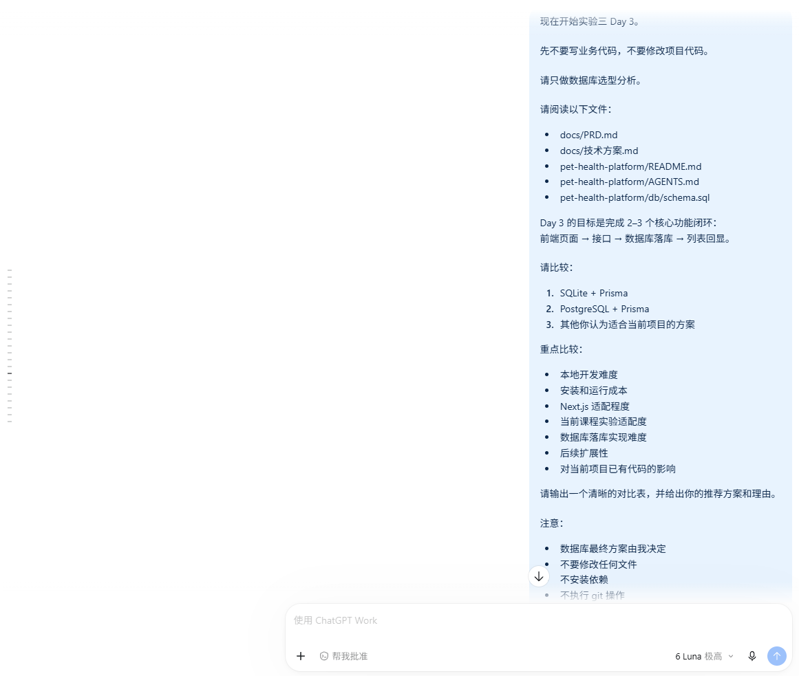
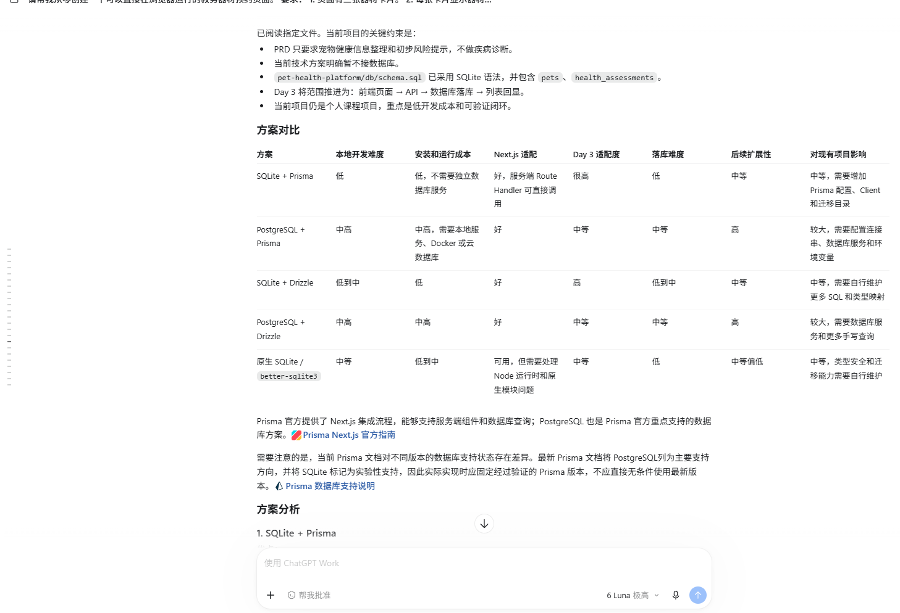
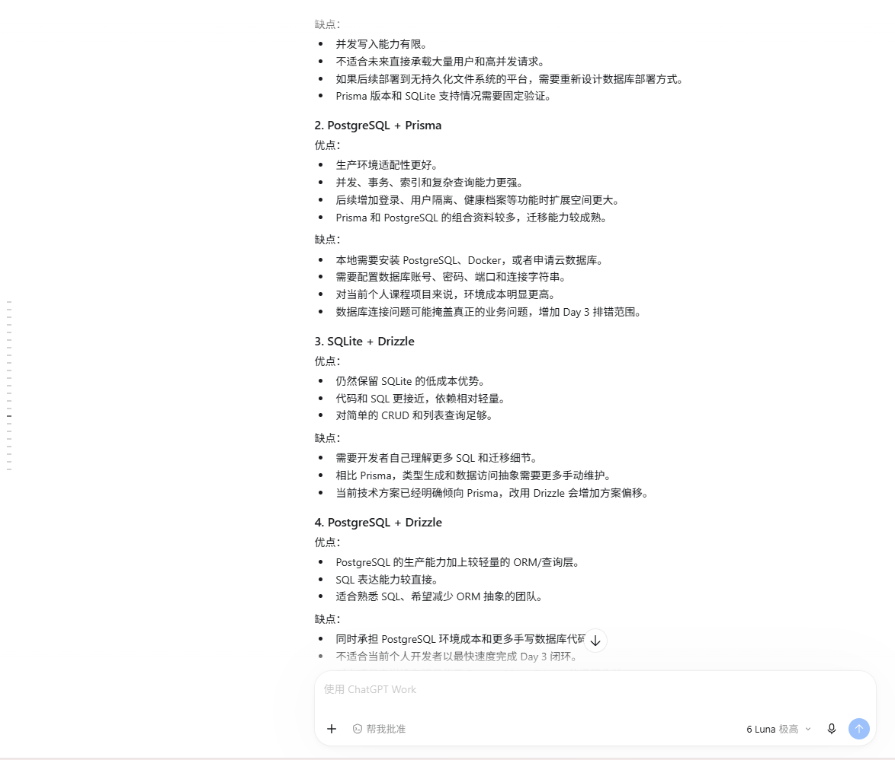
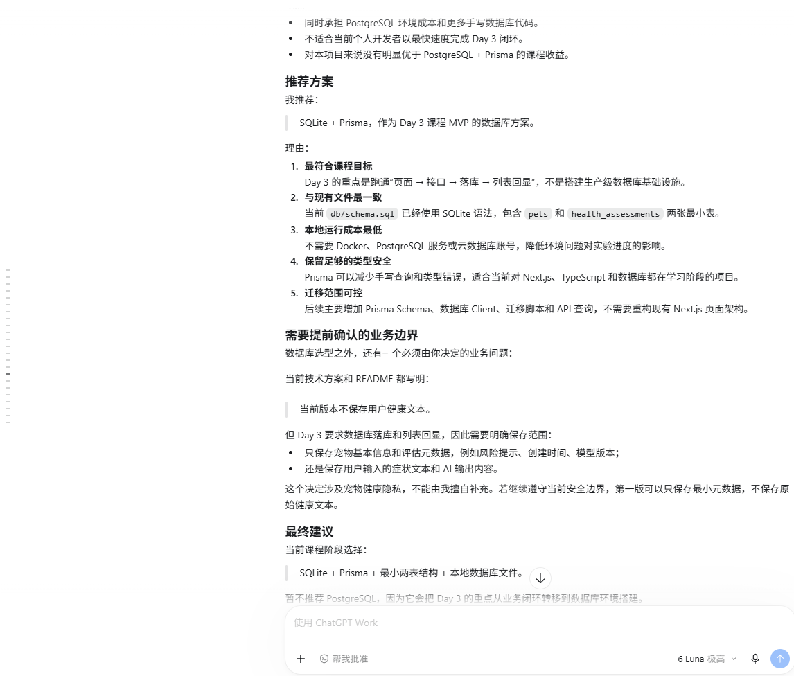
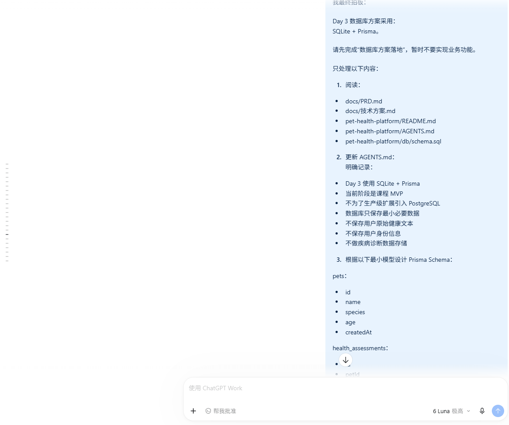
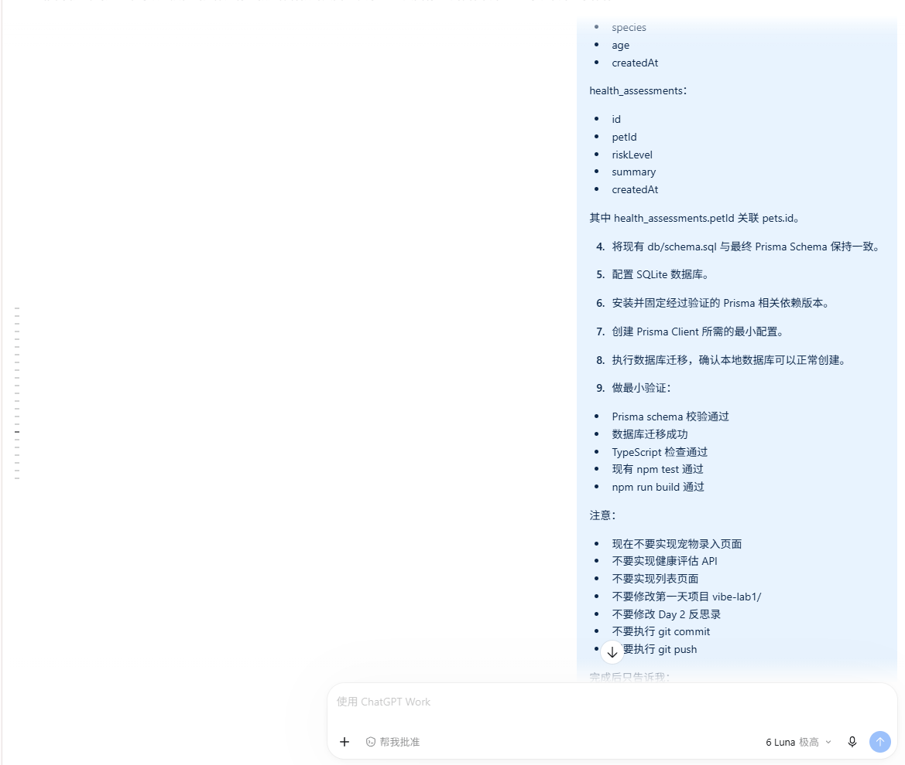
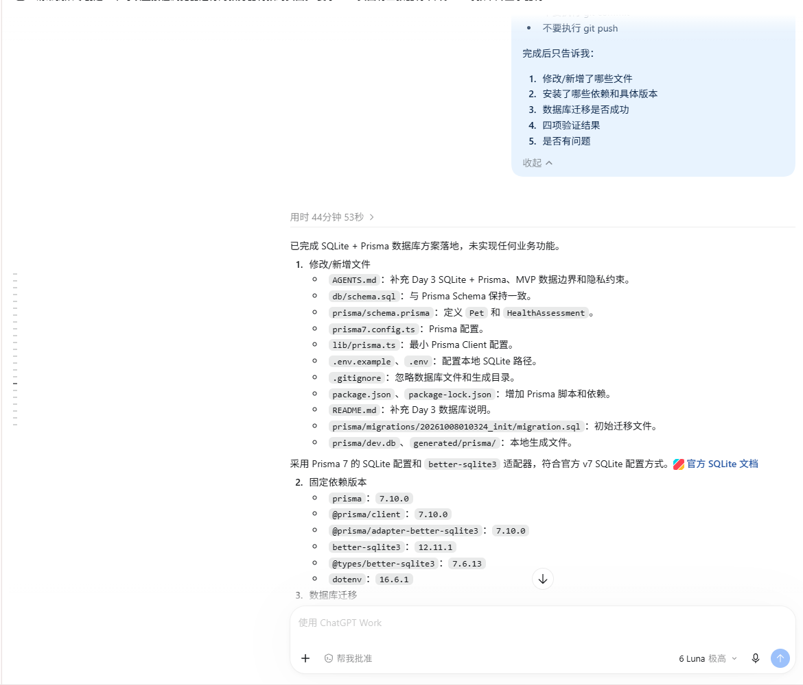

# Day 3 反思录

## 1. 今天完成了什么

今天围绕宠物健康平台 MVP 完成了 Day 3 的两个核心数据闭环：

- 确定并落地 SQLite + Prisma 数据库方案。
- 安装并固定 Prisma 相关依赖，创建 Prisma Client 配置。
- 创建 `pets` 和 `health_assessments` 的最小 Prisma 模型。
- 完成本地数据库迁移，确认 SQLite 数据库可以正常创建和使用。
- 检查并保持 `db/schema.sql` 与 `prisma/schema.prisma` 一致。
- 完成宠物基本信息录入闭环：宠物名称、物种、年龄从前端提交到 `POST /api/pets`，通过 Prisma 写入 SQLite 的 `pets` 表，并把创建结果返回到页面。
- 增加 `GET /api/pets`，让前端可以读取已有宠物并供用户选择。
- 完成健康评估记录闭环：用户选择宠物，填写初步风险提示和观察摘要，通过 `POST /api/health-assessments` 写入 `health_assessments` 表。
- 增加 `GET /api/health-assessments?petId=...`，查询指定宠物的评估记录，并在前端列表展示。
- 保持 `riskLevel` 为用户填写的初步风险提示，没有实现 AI 自动评估、医学风险评分或疾病诊断。
- 增加真实数据库接口测试，测试不仅检查 HTTP 状态和响应内容，也通过 Prisma 查询确认数据确实落库。

今天完成的是数据库基础设施、宠物录入和健康评估记录两个闭环，不代表完整宠物健康 MVP 已经完成。

## 2. 今天实现的完整数据链路

### 2.1 宠物基本信息录入

```text
前端表单
  → POST /api/pets
  → Prisma pet.create()
  → SQLite pets 表
  → 返回创建后的宠物记录
  → 页面显示保存成功
```

为了支持第二个闭环，又增加了：

```text
GET /api/pets
  → Prisma pet.findMany()
  → 前端宠物选择框
```

### 2.2 健康评估记录

```text
前端选择已有宠物并填写内容
  → POST /api/health-assessments
  → 校验 petId、riskLevel、summary
  → Prisma healthAssessment.create()
  → SQLite health_assessments 表
  → GET /api/health-assessments?petId=...
  → 前端读取并展示评估记录列表
```

这里的 `riskLevel` 只是用户输入的“初步风险提示”，不是医学风险评分，也不是疾病诊断。代码没有添加未经验证的疾病规则、关键词规则或医学阈值。

## 3. 我学到了什么

第一，前端、API、ORM、数据库和查询展示之间必须形成可以实际运行的链路。只在接口中返回一个成功对象，并不能证明数据已经保存。必须再次通过 Prisma 查询，或者通过查询 API 读回来，才能确认持久化确实发生了。

第二，SQLite + Prisma 很适合当前课程 MVP。SQLite 不需要单独启动数据库服务，Prisma 又提供了清晰的模型和查询接口，个人开发者可以把精力放在闭环和验收上，而不是先维护复杂基础设施。当前没有为了生产环境提前引入 PostgreSQL。

第三，数据库模型会直接影响 API 和页面设计。`pets.id` 与 `health_assessments.petId` 的关系决定了前端必须先选择一个已有宠物，后端也必须检查这个宠物是否存在。

第四，测试应该从用户真正关心的行为出发。今天的健康评估测试不是只断言 `201`，还检查了数据库中的记录、查询 API 返回的列表以及非法数据的 `400` 响应。

## 4. 今天遇到的问题和返工

### 4.1 Prisma 版本和 Node.js 环境兼容问题

数据库方案刚开始落地时，早期 Prisma 版本在当前 Node.js 环境下执行迁移遇到问题。后来根据错误输出重新确认 Prisma 版本和 SQLite 适配方式，改用经过验证的 Prisma 7.10.0、`@prisma/adapter-better-sqlite3` 7.10.0 和 `better-sqlite3` 12.11.1，最终完成迁移和数据库创建。

这次经历让我认识到，数据库方案不是只写一个 schema 文件，还需要确认运行时、驱动、ORM 版本和迁移命令能够一起工作。

### 4.2 Next.js Route Handler 与 Node 内置测试运行器的差异

宠物录入接口测试最初直接导入 Route Handler。使用 `NextResponse` 时，Node 内置测试运行器无法解析 `next/server` 的导入路径。后来将接口返回改为标准 Web `Response`，同时修正 Route Handler 和 Prisma Client 的 `.ts` 导入路径，测试才可以在 Node 内置测试环境中直接运行。

这不是为了绕过 Next.js，而是因为当前项目的测试策略是直接调用 Route Handler；使用标准 `Response` 仍然符合 Next.js Route Handler 的返回要求，同时让测试保持简单。

### 4.3 构建自动修改 `next-env.d.ts`

运行 production build 后，Next.js 自动把 `next-env.d.ts` 中的类型路径从 `.next/dev/types` 改成了 `.next/types`。检查后确认这是构建产生的自动变化，与本次数据库和业务功能无关，因此在最终检查时恢复了该文件，没有把无关生成差异带入本次修改。

构建时还出现过 Next.js 忽略仓库外 `package-lock.json` 的警告，但不影响编译、TypeScript 检查和页面生成。

## 5. 真实的「提问 → 返工 → 通过」对话档案

### 对话档案一：接口是否真的完成数据库落库

本组截图对应：对话档案 1——数据库方案选择与落地。

截图记录：






**提问：**

“健康评估接口返回 `201`，是否就能说明数据已经写入 SQLite？测试有没有真正验证数据库持久化？”

**返工：**

没有把 HTTP 响应当作唯一证据。健康评估测试先创建一个测试宠物，再调用 `POST /api/health-assessments`；拿到响应中的记录 ID 后，使用 Prisma 的 `healthAssessment.findUnique()` 再查一次数据库。同时调用 `GET /api/health-assessments?petId=...`，确认查询接口也能返回该记录，测试结束后删除测试数据。

宠物录入测试也采用了同样的方式：调用 `POST /api/pets` 后，再用 `prisma.pet.findUnique()` 确认 `pets` 表中存在对应记录。

**通过：**

最终完整测试结果为 `7 passed, 0 failed`。其中包括健康评估创建并持久化、按宠物查询、非法数据返回 `400`，以及原有宠物和 `/api/ping` 测试。

### 对话档案二：新增功能是否形成前端到列表的闭环

本组截图对应：对话档案 2——宠物基本信息录入闭环。

截图记录：





**提问：**

“现在是否只是增加了一个保存接口，还是已经实现了‘选择宠物 → 提交评估 → 查询记录 → 页面列表展示’？”

**返工：**

检查后补齐了完整链路：增加 `GET /api/pets` 供前端选择已有宠物；前端增加健康评估表单；提交后调用 `POST /api/health-assessments`；保存成功后按 `petId` 调用 `GET /api/health-assessments`，并把结果显示在记录列表中。测试也增加了创建后再次查询的断言，而不是只检查返回状态码。

**通过：**

Next.js build 成功生成了 `/api/health-assessments`、`/api/pets`、`/api/ping` 和首页；TypeScript 检查通过；完整测试通过。这样可以确认代码层面的前端、API、Prisma、SQLite 和查询展示结构已经连通。

## 6. 我自己实际验证了什么

- Prisma schema 校验通过。
- 数据库迁移成功，并确认后续迁移检查处于同步状态。
- `npm test` 最终通过：`7 passed, 0 failed`。
- `npm run typecheck` 通过，没有 TypeScript 错误。
- `npm run build` 成功，页面和三个 API 路由均正常生成。
- 宠物测试通过真实 Prisma 查询确认 `pets` 表落库。
- 健康评估测试通过真实 Prisma 查询确认 `health_assessments` 表落库。
- 健康评估查询测试确认 `GET /api/health-assessments?petId=...` 能返回保存的记录。
- 检查 Git diff，确认没有修改 Prisma Schema、migration 或 Day 1 的 `vibe-lab1/`。
- 没有执行 Git commit。

今天没有使用 Playwright，也没有完成浏览器中逐项点击表单的手动验收；当前主要通过接口测试、真实数据库查询、TypeScript 检查和 production build 验证。下一步仍需要在浏览器中手动验证新增页面的交互体验。

## 7. AI 帮我完成了什么

AI 帮助我根据已有技术方案逐步生成：

- SQLite + Prisma 的配置和迁移基础设施。
- 宠物录入页面、`POST /api/pets` 和 `GET /api/pets`。
- 健康评估记录页面、创建 API 和按宠物查询 API。
- 使用真实 SQLite 数据库的接口测试。
- TypeScript 检查和 production build 过程中的问题定位。

但 AI 的代码和汇报都不能直接等同于完成。今天多次通过实际错误输出发现问题，例如缺少 Route Handler、Node 无法解析 `next/server`、导入路径不正确，以及 build 自动改动 `next-env.d.ts`。这些都需要我查看文件、运行命令和检查 Git diff 后才能确认。

## 8. 今天的不足和改进点

- 对 Next.js Route Handler 在 Next.js 构建环境和 Node 直接测试环境中的差异还不够熟悉。
- 对 ESM 导入扩展名、Prisma 生成 Client 和测试运行器之间的关系理解得还不够系统。
- 前端目前把宠物录入和健康评估区域放在同一页面，功能已经闭环，但交互和组件职责还可以继续优化。
- 当前没有浏览器自动化测试，页面交互主要依靠 TypeScript、build 和 API 测试间接验证。
- 需要继续关注测试数据清理、错误提示和空状态，而不是只关注成功路径。
- 需要继续坚持先写测试、先看到 RED，再写最小实现，避免凭感觉判断功能已经完成。

## 9. 明天准备做什么

- 启动本地项目，在浏览器中手动验证新增的宠物选择、健康评估提交和记录列表展示。
- 检查空宠物、无评估记录、非法输入和宠物不存在等页面状态。
- 继续保持 SQLite + Prisma 的简单架构，不提前增加登录、社区、商城或复杂基础设施。
- 根据实际验收结果再决定是否需要小范围修正，不一次性扩展到 AI 自动评估。
- 继续通过测试、TypeScript、build 和 Git diff 验收每个小阶段。

## 总结

今天最大的收获不是“AI 帮我写出了几个接口和页面”，而是开始真正理解一个功能闭环需要经过前端、API、Prisma、SQLite、查询和列表展示多个环节。只有实际写入数据库、再次查询、运行测试并检查构建结果，才能确认功能不是表面上的成功提示。

同时我也更清楚地认识到，宠物健康项目必须严格控制边界：当前只记录用户输入的基本信息和初步风险提示，不编造医学规则，不做疾病诊断，也不把代码中的字符串当成兽医结论。开发者必须对 AI 的生成结果进行实际验收，并对最终提交的代码负责。
